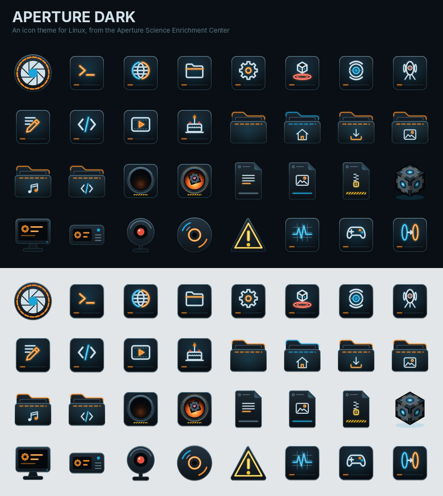
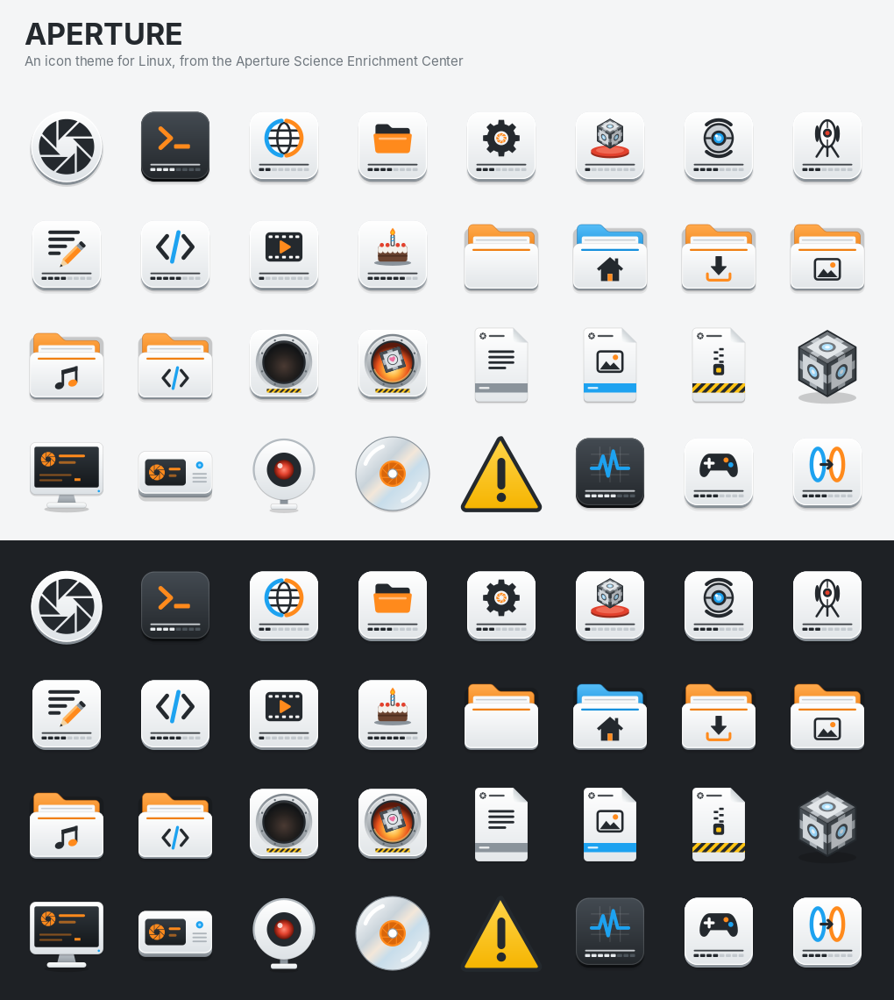

# Aperture icon themes

Two Linux icon themes based on Aperture Science. Both are unofficial fan work.

- **Aperture** looks like the test-chamber signs: white wall panels, black pictograms, and portal orange and blue.
- **Aperture-Dark** is for dark "Aperture OS" desktops. It uses navy steel panels with a teal HUD frame and pale line-art pictograms. The accents glow like the facility's amber ring lights and the core's blue eye. Its colours were sampled from a real Aperture desktop setup, so it sits alongside HUD-style conky widgets.




## What's in them

- **Aperture-Dark** has about 940 drawn icons covering roughly 4,400 icon names:
  - apps (about 130 distinct pictures) and System Settings panels
  - toolbar and menu actions
  - panel and tray status icons: battery levels, Wi-Fi, volume, Bluetooth, notifications, weather, presence
  - file emblems and Git status
  - about 240 file types, each with a glowing HUD label (`PY`, `RS`, `MKV`, `ZIP`…)
  - folders, including colour and open variants, and devices
  - openSUSE: every YaST module (`yast-*`), Myrlyn, Snapper/Btrfs Assistant, openSUSE Welcome, Agama, Cockpit, the openSUSE branding names, and `.ymp`/`.spec`/`.repo` files. These live in `dark_opensuse.py`.
- **Aperture** (light) has about 160 drawn icons.
- Each drawn icon also has a simplified variant that's used at 32 px and below. The variants have thicker lines and drop the fine detail, so taskbars, trays and file lists stay readable.
- Alias symlinks cover the icon names. Alias symlinks map GNOME, KDE, Xfce, Cinnamon/MATE and common third-party app IDs (Firefox, Steam, VS Code, Discord, GIMP, OBS, LibreOffice, …) onto the themed icons.
- Aperture-Dark's action, status and emblem icons are drawn without a panel behind them, for dark toolbars and trays. On a light app they'll look faint.
- Symbolic (monochrome) icons are inherited, not redrawn. Aperture-Dark looks first in Breeze Dark, so KDE trays keep light symbolic icons. If that's missing it falls back to Adwaita.

Some of the Portal references:

| Icon | Drawn as |
|---|---|
| Trash, empty / full | Emergency Intelligence Incinerator, cold / burning a Companion Cube |
| Packages (`.deb`, `.rpm`, …) | Weighted Storage Cube |
| Software centre | Storage cube on a Super Button |
| Help | Personality core |
| Firewall / VPN / security apps | Sentry turret |
| Webcam | Security camera |
| Welcome / tour apps | The cake |
| Remote desktop | A portal pair |
| Web browser | Globe ringed in portal blue and orange |
| Start menu / distro logo | The aperture iris (Aperture-Dark adds a segmented ring light) |

## Install

```sh
./install.sh --dark --apply   # Aperture-Dark for the current user, and switch to it now
./install.sh --apply          # the light Aperture theme instead
./install.sh --dark --system  # all users: /usr/share/icons (uses sudo)
./install.sh --dark --uninstall
```

`--apply` works on GNOME, KDE Plasma, Xfce, Cinnamon, MATE and Budgie. On other desktops, choose the theme in your appearance settings (KDE: System Settings → Colours & Themes → Icons).

To install by hand, copy the theme folder into `~/.local/share/icons/` with `cp -a`, or extract the tarball. A plain copy can break the aliases, because they're symlinks.

Flatpak apps can only use themes they're allowed to read. If they don't pick it up:

```sh
flatpak override --user --filesystem=xdg-data/icons:ro
```

## Changing them

Both themes are generated by Python 3 scripts with no dependencies:

```sh
python3 build.py        # -> Aperture/
python3 build_dark.py   # -> Aperture-Dark/
python3 tools/showcase.py                                         # preview images (needs Pillow + librsvg)
python3 tools/preview.py sheet.png apps --big --dark --theme=Aperture-Dark
```

- **Palettes:** the constants at the top of each script.
- **Light theme pictograms:** the `@glyph` functions in `build.py`.
- **Dark theme pictograms:** the `@glyph` functions in `build_dark.py` and `dark_glyphs.py`. Actions, status icons and emblems are in `dark_actions.py`. App mappings, settings panels, folders and the file-type label table are in `dark_catalog.py`. These are lists of primitives: `S` stroke, `F` fill, `K` knock-out, `BODY` dark steel. The renderer adds the glow and the small-size line weights.
- **App to icon mapping:** `APPS`, `FOLDERS`, `MIMES` and the `ALIASES` table in `build.py`, shared by both themes. To theme an app that isn't covered, add its icon name (the `Icon=` line in its `.desktop` file) and rebuild.

The SVGs use only plain shapes, gradients and transforms. There are no filters, masks or clip paths, and the glow is layered translucent strokes. They render the same in librsvg (GTK) and QtSvg (KDE).

## Legal

This is fan art. Portal, Aperture Science and related names are trademarks of Valve Corporation. The themes aren't affiliated with or endorsed by Valve and contain no Valve assets: every icon is drawn from scratch by the build scripts. They also replace third-party app icons (Firefox, Steam, …) with generic pictograms and don't use those apps' logos. Fine for personal use. Keep this notice if you redistribute them.
