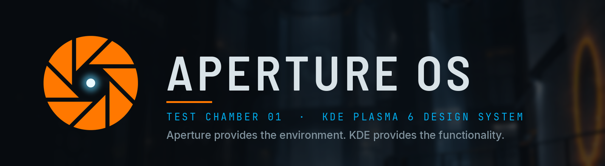
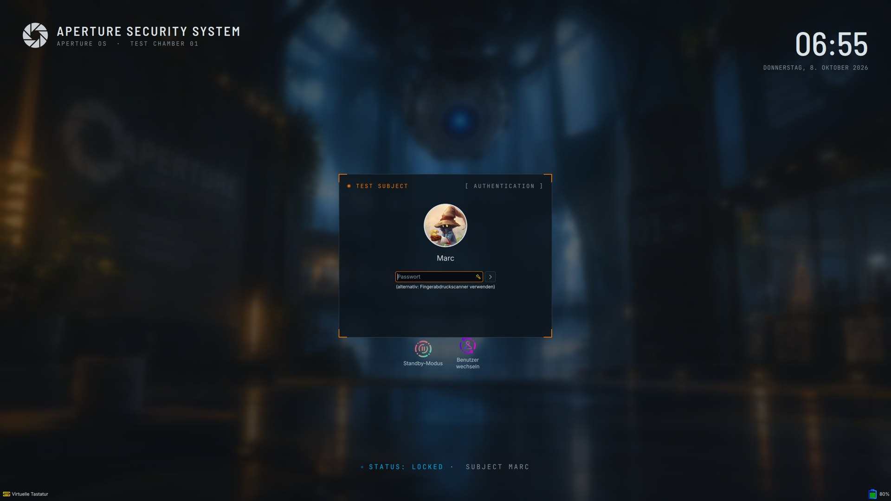
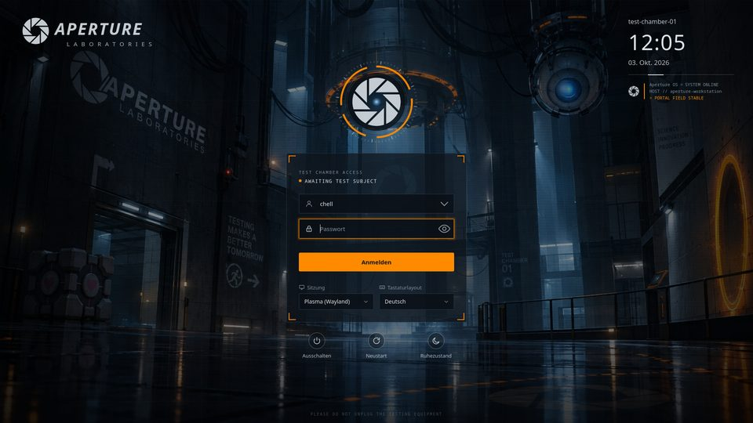
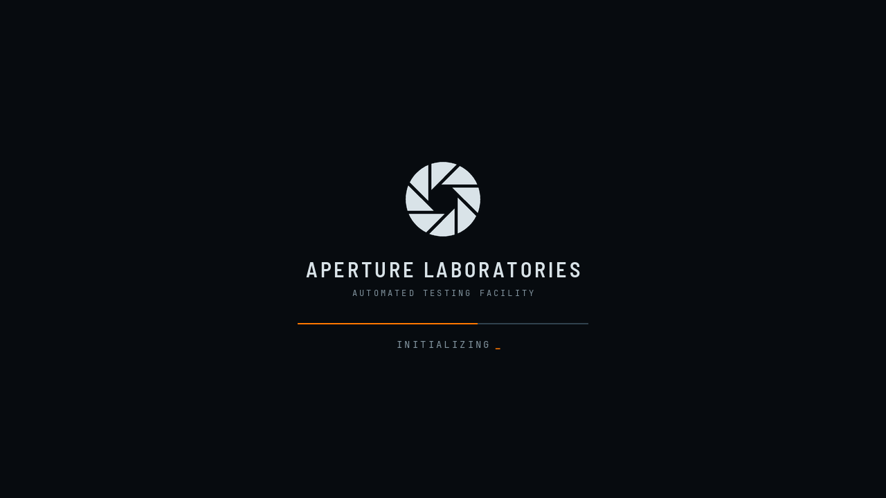
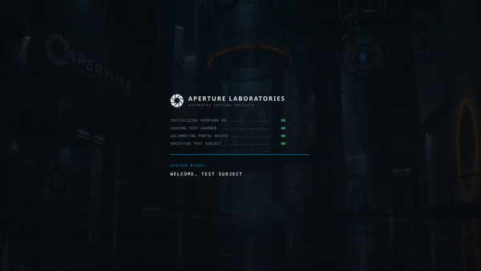

<div align="center">




[Install](#install) • [Gallery](#gallery) • [Components](#components) • [Customising](#customising) • [FAQ](#faq) • [Credits](#credits)

</div>

# ORIGINAL CAN BE FOUND HERE: https://gitlab.com/Quatzler/aperture-os
Welcome to **Aperture OS**! A KDE Plasma 6 design system that turns an existing Kubuntu desktop into a believable
Aperture Laboratories test facility – lock screen, login, boot screen, widgets, animated wallpaper, sounds and a
matching terminal – **without** replacing your icons, cursors, shell or file manager.

> [!IMPORTANT]
> This is a fan project, not affiliated with or endorsed by Valve. Code and original assets are GPL-3.0-or-later
> ([`LICENSE`](LICENSE)). Sounds, voice lines and logo-inspired art come from *Portal* / *Portal 2* (© Valve Corporation)
> and are **not** covered by the GPL – if you redistribute the theme you may need to remove them
> (`sounds/`, `sddm/sounds/portal/`, `sounds/session/`). All third-party and derived parts: [`THIRD_PARTY.md`](THIRD_PARTY.md).

━━━━━━━ ❖ ━━━━━━━

## Install

> [!NOTE]
> Tested on Kubuntu 26.04 · Plasma 6.6 · KWin 6.6 (Wayland) · Qt 6.10. Package names may differ on other distros.

#### 📦 REQUIREMENTS

**Core:** `plasma-workspace`, `kwin`, `kpackagetool6`, `qml6-module-qtquick-shapes`, `curl`, `unzip`, `python3`

**Optional:** `qt6-style-kvantum` (translucent Dolphin) · `ffmpeg`, `python3-pil` (only to rebuild sounds/cursors)

#### 🚀 INSTALLATION

```bash
git clone git@gitlab.com:Quatzler/aperture-os.git && cd aperture-os
./install.sh --activate --fonts   # install + activate (backs up your KDE config first)
```

Everything goes to `~/.local` / `~/.config` – only the SDDM login theme and the Plymouth boot screen need `sudo`
(separate, optional). Without `--activate` nothing is switched. More options: `--no-dotfiles`, `--no-phpstorm`, `--no-session`.
Undo: `./install.sh --rollback` (restore the backup) or `./install.sh --uninstall`.
Emergency exit without a script: System Settings → Global Theme → *Breeze Dark*.

#### 🔊 STARTUP / SHUTDOWN SOUNDS

The main installer also sets up the turret voice lines (systemd user units). Skip them with `--no-session`,
install only them with `sounds/install.sh --session-only`.

#### 💡 RECOMMENDED COMPANIONS

Not included – the theme deliberately leaves them alone (panels, widgets and desktop layout stay yours, too):

| Package | Why |
|---|---|
| [Candy icons](https://github.com/EliverLara/candy-icons) + Sweet-Rainbow folders | the icon set the screenshots use |
| Aperture cursor (included) | the recommended cursor – `cursors/install.sh --activate` |
| Kitty, zsh + Oh My Zsh, Starship, fastfetch | terminal identity – colour configs via `dotfiles/install.sh` |
| `qt6-style-kvantum` | translucent Dolphin (`kvantum/install.sh --activate`) |
| [Burn-My-Windows](https://store.kde.org/p/2133844) (KWin effect) | optional window open/close effects |

━━━━━━━ ◈ ━━━━━━━

## Gallery

**Lock screen – "Aperture Security System"**



**Login (SDDM) – "Aperture Protocol"**



**Boot (Plymouth)** · **Splash screen** · **Widgets**

| Boot | Splash | Widgets |
|---|---|---|
|  |  |  |

━━━━━━━ ༓ ━━━━━━━

## Components

| Folder | What |
|---|---|
| `design/` | **Design tokens** (`tokens.json`) – the single source for colours, transparency, radii, fonts, animation |
| `dotfiles/` | kitty, Starship, fastfetch – see [`dotfiles/README.md`](dotfiles/README.md) |
| `tools/` | `build-all.sh`, `build-dotfiles.py`, `fonts.sh`, `package-store.sh` |
| `colors/` | Colour scheme **ApertureOS** |
| `plasma-style/` | Plasma style (panel, popups, launcher, notifications, widgets, task bar) |
| `aurorae/` | Window decoration |
| `globaltheme/` | Global theme (Look-and-Feel) + optional panel layout |
| `splash/` | Splash screen "INITIALIZING APERTURE OS" |
| `lockscreen/` | Lock screen "Aperture Security System" |
| `wallpaper/` | Test chamber wallpaper + optional animated wallpaper plugin |
| `widgets/` | Plasmoids: Test Chamber, System Monitor, Aperture Notice |
| `launcher/` | Application launcher `aperture-os.launcher` (replaces Kickoff, Meta key) |
| `sounds/` | System sound theme + turret login/shutdown sounds |
| `cursors/` | Aperture cursor pack – the recommended cursor (opt-in, falls back to Breeze) |
| `phpstorm/` | PhpStorm UI theme + editor colour scheme |
| `kate/` | Kate/KWrite colour scheme (same syntax palette as PhpStorm) |
| `guard/` | Plasma update guard: tests the lock/logout screen after updates and disables them automatically on failure |
| `kvantum/` | Kvantum theme – translucent Dolphin (Dolphin only, everything else stays Breeze) |
| `sddm/` | Login screen "Aperture Protocol" |
| `plymouth/` | Boot screen (rotating iris, progress line, LUKS password prompt) |

Everything lives in **one** repo. Each component has its own `README.md` and `install.sh` and works on its own.

━━━━━━━ ❖ ━━━━━━━

## Activate components

### Activate the global theme

`./install.sh --activate` or: **System Settings → Colors & Themes → Global Theme → Aperture OS**.
The package contains no desktop layout – your panels and widgets are always kept.

### Individual components

| Component | System Settings | Command line |
|---|---|---|
| Colours | Colors & Themes → Colors → *Aperture OS* | `colors/install.sh --activate` |
| Plasma style | Colors & Themes → Plasma Style → *Aperture OS* | `plasma-style/install.sh --activate` |
| Window decoration | Colors & Themes → Window Decorations → *Aperture OS* | `aurorae/install.sh --activate` |
| Splash screen | Colors & Themes → Splash Screen → *Aperture OS* | `splash/install.sh --activate` |
| Wallpaper | Right-click desktop → Configure Desktop and Wallpaper | `wallpaper/install.sh --activate` / `--animated` / `--toggle` |
| Launcher (instead of Kickoff) | – | `launcher/install.sh --activate` (`--deactivate` = back to Kickoff) |
| System sounds | Colors & Themes → System Sounds → *Aperture OS* | `sounds/install.sh --activate` |
| Cursor (optional) | Colors & Themes → Cursors → *Aperture Cursors* | `cursors/install.sh --activate` |
| Panel layout (optional) | – | `globaltheme/install.sh --apply-layout` |
| Lock screen | – | `lockscreen/install.sh --activate --now` (see [README](lockscreen/README.md)) |
| Translucent Dolphin | – | `kvantum/install.sh --activate` (needs `qt6-style-kvantum`) |
| Widgets | Right-click desktop → Add Widgets → "Aperture" | `widgets/install.sh` |
| Login screen (SDDM) | Colors & Themes → Login Screen | `sudo sddm/install.sh` (colours/fonts from the tokens, fonts included) |
| Kate / KWrite | Configure Kate → Color Themes | `kate/install.sh --activate` |
| Boot screen (Plymouth) | – | `sudo plymouth/install.sh --test`, then `--activate` (see [README](plymouth/README.md)) |

---

## Uninstall & rollback

```bash
./install.sh --uninstall   # remove everything, back to Breeze Dark (icons/cursors were never changed)
./install.sh --rollback    # restore the most recent KDE configuration backup
./install.sh --rollback ~/.local/state/aperture-os/backup-20261004-093555-initial   # a specific backup
```

Backups live in `~/.local/state/aperture-os/`:

| File/folder | Content |
|---|---|
| `backup-<time>/` | kdeglobals, kwinrc, plasmarc, ksplashrc, kscreenlockerrc, breezerc, kcminputrc, plasmashellrc, panel configuration – created on every `--activate`/`--uninstall` |
| `backup-<time>-initial/` | State **before** Aperture OS (first run) + kitty/starship |
| `dotfiles/` | Originals of kitty.conf / starship.toml |
| `fonts.prev`, `sound-theme.prev` | previous font and sound settings |

Quick emergency exit without a script: System Settings → Global Theme → *Breeze Dark*.

---

## Customising

### Colours

All colours are in [`design/tokens.json`](design/tokens.json):

```text
background #070B0F   surface #0D151C   surfaceElevated #111D25   border #30424E
text #D9E3E8         textMuted #81939E orange #FF7800            blue #00AEEF
success #4FD18B      warning #FFB000   error #FF4545
```

Rule: **orange = interaction/focus**, **blue = system status/info**, **green = success**, **red = error**.
After a change:

```bash
tools/build-all.sh --install      # distribute tokens, regenerate everything, install
./install.sh --activate
```

All text/background combinations meet WCAG AA (text 15:1, muted text ≥ 4.9:1, orange/blue ≥ 5.9:1).

### Transparency

`design/tokens.json → alpha` (1.0 = opaque):

| Key | Default | Affects |
|---|---|---|
| `panel` | 0.82 | Panel (set panels to "translucent") |
| `glass` | 0.84 | Popups, launcher, notifications, KRunner |
| `widget` | 0.80 | Desktop widgets |
| `tooltip` | 0.96 | Tooltips |
| `terminal` | 0.88 | kitty |

Context menus: `kwriteconfig6 --file breezerc --group Style --key MenuOpacity 92` (0–100).
Active dialogs, password and error dialogs deliberately stay opaque (Breeze).

### Animation

`design/tokens.json → motion` (`fast`, `normal`, `slow`, `pulse` in ms; `reduceMotion: true` turns off
continuous animations in the splash, lock screen, widgets and cursors). The animated wallpaper has its own
settings (animation on/off, intensity, updates per second – default 10, mirror, zoom/crop).

### Fonts

| Role | Font | Where |
|---|---|---|
| UI | **Inter** | KDE interface, body text in splash/lock/logout screens |
| Titles / display | **Barlow Semi Condensed** | "APERTURE SECURITY SYSTEM", "TEST CHAMBER 01", clocks – DIN-like, as on Portal signage |
| Technical labels, editor | **JetBrains Mono** | status labels, PhpStorm, KDE monospace |
| Terminal | FiraCode Nerd Font Mono | kitty (Nerd symbols for Starship) |

`tools/fonts.sh` downloads Inter, JetBrains Mono and Barlow Semi Condensed (all SIL OFL) to
`~/.local/share/fonts/aperture-os`. `--apply` sets them as KDE fonts, `--restore` restores the old values.
The terminal keeps *FiraCode Nerd Font Mono* (needed for the Starship symbols).

---

## Launcher, widgets & wallpaper

* **Launcher:** `launcher/install.sh --activate` replaces Kickoff with `aperture-os.launcher` in all panels
  (backs up the panel configuration first; Kickoff settings are kept). The Meta key opens it.
  Search via KRunner, favourites, categories, session buttons. Details: [`launcher/README.md`](launcher/README.md).
* **Widgets:** `widgets/install.sh`, then right-click the desktop → *Add Widgets* → "Aperture".
  Details: [`widgets/README.md`](widgets/README.md).
* **Wallpaper:** two variants, switchable at any time:

  | Command | Effect |
  |---|---|
  | `wallpaper/install.sh --activate` | static test chamber image on all desktops + lock screen |
  | `wallpaper/install.sh --animated` | plugin `aperture-os.chamber` on all desktops |
  | `wallpaper/install.sh --toggle` | animation on/off (the image stays) |
  | `wallpaper/install.sh --static` | back to the static image |
  | `wallpaper/install.sh --frame N ZOOM X Y [mirror]` | crop for Plasma screen N |

  The animated wallpaper's effects come from the photo's own pixels (no painted-on shapes):
  a light ring sweeps around in 15° sectors once every 10 s, a light cone under the core, the door behind the cube,
  core pulse, portal rim, dust particles. 10 frames/s, about 3 % CPU. Settings: right-click desktop →
  Configure Desktop and Wallpaper (animation, intensity, frames per second, mirror, zoom/crop).
* **Boot screen:** Plymouth theme with a rotating iris and LUKS password prompt – system-wide, therefore not part of
  `./install.sh`. Test on a text console first: [`plymouth/README.md`](plymouth/README.md).

## Language

The system language decides; German and English are supported.

* **Plasmoids** (launcher, Test Chamber, System Monitor, Notice): English source strings, German translation in
  `<component>/po/de/*.po`. `tools/build-l10n.py` compiles them into the packages (`contents/locale`), they are installed
  with the plasmoid. Already placed widgets only load new translations after `systemctl --user restart plasma-plasmashell`.
* **Date** on the lock screen follows the locale (`Qt.locale()`).
* **Lab texts** ("TEST CHAMBER 01", "INITIALIZING", "SECURITY CLEARANCE REQUIRED" …) deliberately stay English.
* Still open: the animated wallpaper's configuration dialog (English only).

Rules for new strings: [`docs/CONVENTIONS.md`](docs/CONVENTIONS.md#language-i18n).

## Known limitations

* **Dolphin transparency** needs Kvantum (`sudo apt install qt6-style-kvantum`) because Breeze cannot do
  translucent windows. Kvantum applies to Dolphin only (desktop-file override); all other
  applications stay on Breeze.
* **Lock screen:** Plasma 6.6 loads it from the shell package; it is activated via
  `plasmashellrc [Shell] ShellPackage`. The panel configuration is shared via symlink
  (see `lockscreen/README.md`). Check briefly after Plasma updates – the `guard/` component does this automatically.
* **Notifications:** The popups come from the compiled-in `org.kde.plasma.notifications`.
  The Plasma style supplies the glass background, 1 px border and header. Two colours cannot be controlled
  separately: the progress bar of normal notifications is the global accent colour (orange) and the side stripe
  of critical notifications is `NeutralText` (amber). Custom colours for info/success/warning/error need a fork in
  Plasma 6. The desktop widget *Aperture Notice* shows notifications with this colour logic.
* **Wallpaper:** 1920/2560/3840 px, upscaled with Real-ESRGAN (ncnn/Vulkan) from the 1672×941 original,
  20 % classically scaled blended in + fine grain (against the "plastic look" and banding).
* **KWin effects:** `--activate` only turns on blur (strength 6, slight noise against banding).
  Window animations stay your choice (e.g. the Burn-My-Windows glitch).
  Global animation duration: `kdeglobals [KDE] AnimationDurationFactor=0.8`.
* **Window decoration:** Aurorae only reloads changes to an already active theme after a
  theme switch (or re-login) – `aurorae/install.sh --activate` is not always enough.
* GTK applications pick up colours through KDE's GTK integration, but not system sounds.

## Extending

New components follow [`docs/CONVENTIONS.md`](docs/CONVENTIONS.md): own folder/repo, `install.sh`,
`README.md`, `tokens.json`, optionally `tools/build.py`. Register them in `tools/build-all.sh` (COMPONENTS) and
`install.sh`. Ideas for later: [`docs/ROADMAP.md`](docs/ROADMAP.md). Prepared for: more test chambers (copy the wallpaper
package), more widgets (`widgets/` package structure), KWin animations, GLaDOS messages (Notice widget).

## Repo / Git

Monorepo. A component can be split into its own repo with `git subtree split --prefix=<folder>`.

**CI** (`.gitlab-ci.yml`, image `ubuntu:26.04`): `build` checks that `tools/build-all.sh` reproduces all committed
generated text files exactly (images excluded). `lint` (`tools/lint.sh`, also usable locally) parses
JSON/XML/SVG, compiles Python, checks shell scripts (`bash -n`, shellcheck warnings) and QML (`qmlformat`).

The component folders are built to work without the main repo (own `tokens.json`,
`install.sh`, `README.md`). Only `tools/build-all.sh` (token distribution) lives in the main repo.

## Publishing (store.kde.org)

`tools/package-store.sh` builds one package per component into `dist/` (global theme, Plasma style, window
decoration, splash, lock screen, launcher, cursors, widgets, wallpaper, colour scheme, SDDM). There is no
hard-coded user data: the name in the launcher and in the Starship prompt comes from the account, and the panel
layout adapts to the number of screens.

Releases are cut by tagging: pushing a tag `vX.Y.Z` runs the CI jobs `package` and `release`, which build `dist/`,
upload it to the GitLab package registry and create a GitLab release with every package attached and the
matching section of [`CHANGELOG.md`](CHANGELOG.md) as release notes.

## FAQ

#### 🛠️ The lock screen is black / broken after a Plasma update?
Plasma 6.6 loads the lock screen from the shell package, which updates can break. The `guard/` component tests it
after every update and disables it automatically on failure; see [`guard/README.md`](guard/README.md).

#### 🪟 Dolphin is not translucent?
Install `qt6-style-kvantum` and run `kvantum/install.sh --activate` (Dolphin only, everything else stays Breeze).

#### 🎵 No startup/shutdown sound?
Check `systemctl --user status turret-sounds.service`, and that you did not install with `--no-session`.

#### 🖼️ Window decoration did not change?
Aurorae only reloads an already active theme after a theme switch or re-login.

━━━━━━━ ◈ ━━━━━━━

## Credits

* **Valve** – *Portal* / *Portal 2* sounds, voice lines and motifs ([Portal Wiki turret voice files](https://theportalwiki.com/wiki/Category:Turret_voice_files)). Fan project, not affiliated.
* **Candy icons / Sweet-Rainbow folders** by EliverLara – the companion icon theme.
* **KvFlat** (Tsu Jan), **Inter**, **JetBrains Mono**, **Barlow Semi Condensed**, **Real-ESRGAN** and the KDE QML this
  theme builds on – see [`THIRD_PARTY.md`](THIRD_PARTY.md).

_Make your desktop a test chamber._
