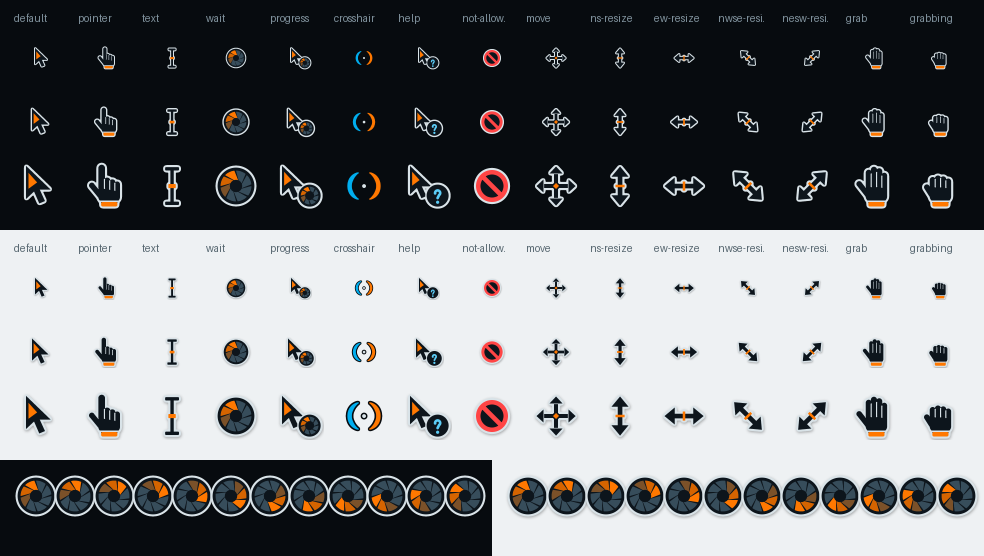

# Aperture-cursors

Optional mouse cursor theme for **Aperture OS** (KDE Plasma 6, Wayland and X11) –
inspired by Aperture Laboratories / Portal: dark body (`surface`), a light,
1-px-like outline for legibility on light **and** dark backgrounds, sparing
orange accents, a calm HMI look instead of neon.

This is the recommended cursor for Aperture OS. It is only installed,
not activated automatically – activate it with `./install.sh --activate` (see below).



## Included cursors

| Cursor | Design | Important aliases |
|---|---|---|
| `default` | Arrow, dark with a light outline, orange wedge | `left_ptr`, `arrow`, `top_left_arrow` |
| `pointer` | Hand with an orange cuff | `hand`, `hand1`, `hand2`, `pointing_hand` + Qt hashes |
| `text` | I-beam with an orange caret stroke | `xterm`, `ibeam` |
| `wait` | animated Aperture iris (12 frames, rotating orange blades) | `watch` |
| `progress` | Arrow + small animated iris | `left_ptr_watch`, `half-busy` + hashes |
| `crosshair` | Portal crosshair: blue bracket on the left, orange on the right | `cross`, `tcross` |
| `help` | Arrow + badge with a blue "?" (blue = info) | `question_arrow`, `whats_this`, `left_ptr_help` |
| `not-allowed` | red prohibition sign (red = error) | `forbidden`, `crossed_circle`, `no-drop` |
| `move` | Four-way arrow with an orange diamond | `fleur`, `all-scroll`, `size_all` |
| `ns-resize` / `ew-resize` | Double arrows | `n-/s-resize`, `row-resize`, `size_ver`, `sb_v_double_arrow` … |
| `nwse-resize` / `nesw-resize` | diagonal double arrows | `size_fdiag`, `bd_double_arrow`, `size_bdiag`, `fd_double_arrow` … |
| `grab` / `grabbing` | open / closed hand | `openhand`, `closedhand`, `dnd-none` |

All other cursor names (e.g. `copy`, `alias`, `pencil`, `zoom-in`, `color-picker`) are inherited from
Breeze via `Inherits=breeze_cursors`.

Sizes per file: 24, 32, 36, 48, 64, 72, 96 px (Plasma default 24; HiDPI 48/72/96).

## Installation

```bash
./install.sh
```

Copies `Aperture-cursors/` to `~/.icons/Aperture-cursors`. The active cursor
is **not** changed.

## Activation

- **System Settings → Colors & Themes → Cursors** → choose "Aperture Cursors" → Apply, or
- Terminal: `plasma-apply-cursortheme Aperture-cursors`, or
- directly during installation: `./install.sh --activate`

Some applications (especially XWayland/GTK) only pick up the new cursor after the application is
restarted or after logging out and back in.

## Back to Breeze (or your previous cursor)

```bash
plasma-apply-cursortheme breeze_cursors
```

or choose another cursor in **System Settings → Colors & Themes → Cursors**.

## Uninstallation

```bash
./install.sh --uninstall
```

Removes only `~/.icons/Aperture-cursors`. If the theme was active, switch to another cursor
first (or afterwards), otherwise Plasma falls back to Breeze.

## Rebuilding / customization

```bash
python3 tools/build.py     # regenerates Aperture-cursors/ and preview.png
python3 tools/verify.py    # reads back all Xcursor files and checks sizes/hotspots/alpha
./install.sh               # install again
```

- Colors and `motion.reduceMotion` come exclusively from `tokens.json`
  (a copy of `design/tokens.json`). With `reduceMotion: true`, `wait`/`progress` are static.
- The shapes are defined procedurally on a 32×32 grid in `tools/build.py`
  (functions `make_*`), aliases in `ALIASES`, sizes in `SIZES`.
- Drawing is done with 8x supersampling and downscaled with a box filter; the script writes the Xcursor files
  (premultiplied ARGB, little-endian) itself – no inkscape,
  rsvg-convert or xcursorgen needed.
- **Deviation from CONVENTIONS.md:** `build.py` additionally requires **Pillow** (`python3-pil`),
  because clean antialiasing is not possible without a raster graphics library. `verify.py` and
  `install.sh` only need the standard library. The generated files are checked in,
  so no build is needed for installation.

## Notes

- Original, procedurally drawn graphics – no official Portal assets included.
- Under Wayland, KWin scales the cursors; existing sizes are preferred, hence the many
  size steps.
