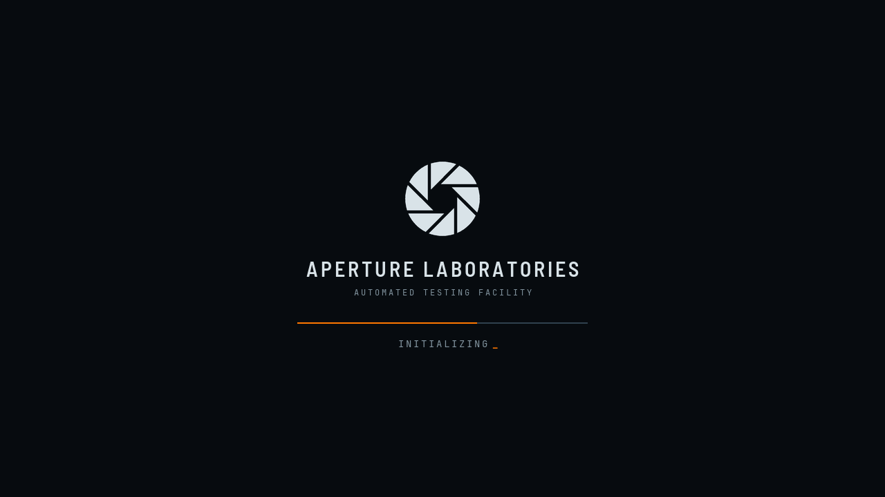
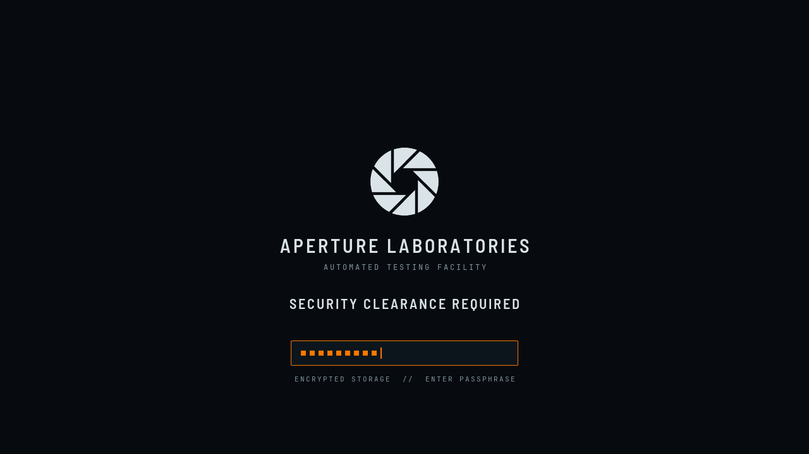

# Aperture OS – Plymouth Boot Screen

An animated boot screen for the phase **before** login: rotating Aperture iris, "APERTURE LABORATORIES",
progress line and status with a blinking cursor. With an encrypted root partition (LUKS), the passphrase prompt
"SECURITY CLEARANCE REQUIRED" appears in the same place.

| Booting | LUKS prompt |
|---|---|
|  |  |

> ⚠️ The Aperture logo is Valve-owned fan-project material, not covered by the GPL, and credited in the main README.

## What it can do

* **Modes:** boot ("INITIALIZING", progress), shutdown / restart ("SHUTTING DOWN" / "RESTARTING",
  scan line instead of progress), updates and firmware (progress + "DO NOT POWER OFF").
* **Password** (`cryptsetup`): prompt text from the system, input field with an orange focus frame, one square per character,
  blinking cursor, **CAPS LOCK** hint in red.
* **Questions** (`plymouth ask-question`): same box, input in plain text.
* **Messages** at the bottom edge; errors (e.g. wrong passphrase) in red.
* **Multiple screens:** content is centered on each screen and realigned on hotplug.
* `motion.reduceMotion` in the tokens: the iris stands still, the cursor does not blink, shutdown shows a full line.

All fixed texts are PNGs (the initramfs only contains the Ubuntu font). Prompt and messages arrive at runtime
and are drawn with the default font. Refresh 25 Hz, one iris step (1.5°) every 80 ms.

## Installation

The theme is installed system-wide, so it needs `sudo`. The main repo's `./install.sh` does not touch it.

```bash
sudo plymouth/install.sh              # install only
sudo plymouth/install.sh --test       # test on a text console (see below), activates nothing
sudo plymouth/install.sh --activate   # activate + rebuild the initramfs
```

**Test first, then activate.** The test has to run on a text console, because Plymouth and KWin cannot share the
screen:

1. `Ctrl+Alt+F3`, log in.
2. `sudo <repo>/plymouth/install.sh --test` (from the repository root: `sudo plymouth/install.sh --test`)
3. The splash with progress appears, then the password field: type anything (it is discarded), press Enter.
   A red test message follows, then the test ends.
4. The console shows any script errors from the debug log. Return to your session with `Ctrl+Alt+F1` or `F2`.

During the test the theme additionally draws a **measuring aid** (orange): a crosshair through the computed center, a frame and
a small cross per screen, and in the top left the values Plymouth reports. Afterwards the normal version is installed again.

**Colors in the test:** If **HDR / wide color gamut** is on for a screen in KWin, the monitor stays in
HDR mode during the test and shows Plymouth's sRGB colors distorted (e.g. bluish). During a real boot KWin is not running yet,
so the colors are correct.

`--activate` does the following:

1. on the first run, backs up `/etc/plymouth/plymouthd.conf` and the state of `default.plymouth` to
   `/var/lib/aperture-os/plymouth/`,
2. registers the theme as an alternative for `default.plymouth` and selects it (this is the path the
   initramfs hook uses),
3. sets `[Daemon] Theme=aperture-os` in `plymouthd.conf` (shutdown),
4. rebuilds the initramfs of the **newest** kernel with `update-initramfs -u`. Older kernels keep their
   previous boot screen: fallback via GRUB → *Advanced options*.

## Rollback

```bash
sudo plymouth/install.sh --deactivate   # restore the backed-up plymouthd.conf + default.plymouth, rebuild the initramfs
sudo plymouth/install.sh --uninstall    # additionally remove /usr/share/plymouth/themes/aperture-os
```

By hand: `sudo update-alternatives --auto default.plymouth`, enter the old
`Theme=` value in `/etc/plymouth/plymouthd.conf`, run `sudo update-initramfs -u`.

**Emergency at boot** (e.g. password field invisible): You can still type the passphrase blind and confirm it with
Enter. Alternatively, in GRUB select the entry, press `e`, delete `splash` in the `linux` line,
press `Ctrl+X`: `cryptsetup` then asks in text mode. Or start an older kernel under *Advanced options*.

## Customization

Colors and `reduceMotion` come from `tokens.json`. Layout values (iris size, line width, field size) are at the top
of `tools/build.py`, the logic is in `src/aperture-os.script.in`. Afterwards:

```bash
python3 plymouth/tools/build.py        # needs python3-pil; fonts from ~/.local/share/fonts/aperture-os
sudo plymouth/install.sh --activate    # or just install + update-initramfs -u
```

`build.py` generates everything in `aperture-os/` (committed): `iris-0…29.png` (the logo from
`widgets/shared/aperture-logo.template.svg`, rotated in 1.5° steps, 8 blades = 45° period), text PNGs,
`aperture-os.script`, `aperture-os.plymouth` and the two preview images.

## Background

* Kubuntu 26.04 builds the initramfs with **initramfs-tools**. Its Plymouth hook only copies the theme that
  the `default.plymouth` alternative points to. `Theme=` in `plymouthd.conf` alone is not enough.
* Script API according to `script.so` of this Plymouth version (24.004), including `SetDisplayPasswordFunction`,
  `SetDisplayQuestionFunction`, `SetDisplayMessageFunction`, `SetHideMessageFunction`,
  `SetDisplayHotplugFunction`, `SetSystemUpdateFunction`, `GetCapslockState`, `SetRefreshRate`.
