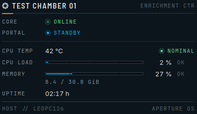
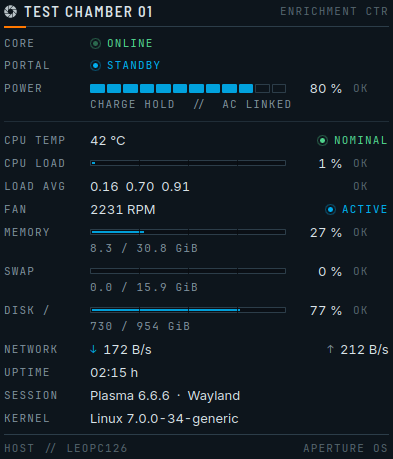
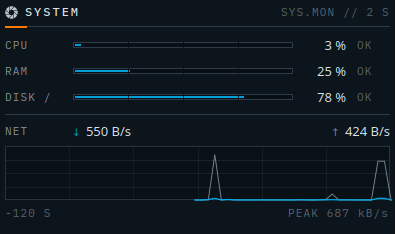
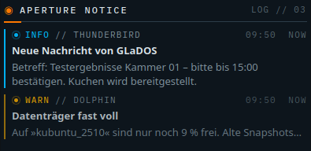
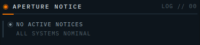

# Aperture OS – Widgets (Plasma 6)

Three plasmoids in the style of a calm industrial HMI for the Aperture OS desktop theme:
dark, slightly transparent (they use the normal widget background of the `aperture-os` Plasma style,
including its corner angles), thin 1 px lines, small mono labels used only as an accent, values in the UI font.

Color logic: **orange** = interaction/focus (header line, active panel icon),
**blue** = info/status, **green** = OK, **amber** = warning, **red** = error.
States are always shown as text next to an LED as well (`ONLINE`, `STANDBY`, `WARN` …).

> The Aperture emblem is a Portal motif. It is Valve-owned fan-project material, not covered by the GPL, and is credited in the main README.

## The widgets

### Aperture Test Chamber – `aperture-os.testchamber`




Status panel with the header `TEST CHAMBER 01` (chamber number is configurable). Each row can be switched
on or off individually; the order is fixed. Rows for which this machine has no sensor are hidden automatically.

| Row | Content | Source (sensor ID) | Default |
|---|---|---|---|
| `CORE` | `ONLINE` (green, LED pulses slowly), `STRAINED` (amber) or `OVERHEAT` (red) – follows the CPU temperature | `cpu/all/averageTemperature` | on |
| `PORTAL` | `STANDBY` (blue) – pure atmosphere | – | on |
| `POWER` | Battery level as a segmented bar + `OK`/`LOW`/`CRIT`, detail line `CHARGING`/`DISCHARGING`/`CHARGE HOLD`/`FULL` and `AC LINKED`/`AC OFFLINE`. Hidden without a battery | powermanagement data source | **off** |
| `CPU TEMP` | average CPU temperature with `NOMINAL` / `WARN` (above the threshold, default 80 °C) / `CRITICAL` (threshold + 10 °C) | `cpu/all/averageTemperature` | on |
| `CPU LOAD` | overall utilization as a bar + `OK` / `HIGH` (≥ 85 %) / `CRIT` (≥ 95 %) | `cpu/all/usage` | on |
| `LOAD AVG` | load average 1/5/15 min; `HIGH` once the load is ≥ the number of logical CPUs, `CRIT` at twice that | `cpu/loadaverages/loadaverage1` … `15`, `cpu/all/cpuCount` | off |
| `GPU` | GPU utilization as a bar, detail line with temperature | `gpu/gpuN/usage`, `gpu/gpuN/temperature` (first device found) | off |
| `FAN` | fan speed in RPM + `ACTIVE` / `IDLE` | `lmsensors/<chip>/fanN` (first fan found, `acpi_fan` only as a fallback) | off |
| `MEMORY` | used RAM as a bar, detail line `used / total GiB` | `memory/physical/usedPercent`, `…/used`, `…/total` | on |
| `SWAP` | used swap, detail line in GiB. Hidden without swap | `memory/swap/usedPercent`, `…/used`, `…/total` | off |
| `DISK /` | usage of the root filesystem, detail line in GiB | `disk/<UUID of />/usedPercent` (UUID via `findmnt`), fallback `disk/all/…` (label then `DISK`) | off |
| `NETWORK` | current download/upload rate (history graph: see System Monitor) | `network/all/download`, `network/all/upload` | off |
| `UPTIME` | uptime | `os/system/uptime` | on |
| `SESSION` / `KERNEL` | Plasma version and windowing system, or kernel (two lines, one switch) | `os/plasma/plasmaVersion`, `os/plasma/windowsystem`, `os/kernel/prettyName` | off |
| Footer `HOST` | host name | `os/system/hostname` | on |

**Taskbar:** In a panel the widget shows LED + `CH01` by default. Under "Taskbar" in the settings you can
instead pick any number of values (chamber number, CPU temperature/load, memory, swap, disk, GPU, fan,
battery, network, uptime). This is independent of the popup rows; click-to-expand can be switched off separately.
Values without a sensor are skipped.

**Notes on the sensors**

- All values come from KSystemStats (the same service Plasma's System Monitor uses). Only the sensors of
  visible rows are subscribed to, updated at most every 2 s (temperature/fan/GPU 4 s,
  disks 10 s, system info 30–60 s).
- GPU and fan IDs depend on the machine. The widget therefore runs `kstatsviewer --list` once
  (part of `ksystemstats`) to look for `gpu/gpuN` and `lmsensors/…/fanN` – only if one of the two rows
  is enabled.
- The `GPU` row only appears once the driver delivers real values. Intel iGPUs (e.g. Core Ultra 5 125U)
  currently report only 0 for utilization and temperature in KSystemStats – the row stays hidden there.
- `FAN` on ThinkPads: `lmsensors/thinkpad-isa-0000/fan1`.
- Show all available sensors: `kstatsviewer --list`, single values live: `kstatsviewer --remain <id>`.

### Aperture System Monitor – `aperture-os.sysmonitor`



- `CPU`, `RAM`, `DISK /` as thin bars with a percentage and a state of `OK` / `HIGH` (≥ 85 %) / `CRIT` (≥ 95 %).
  The disk is automatically the root filesystem `/` (UUID determined once via `findmnt`,
  fallback to `disk/all`); any sensor ID can be entered in the settings.
- `NET`: current download/upload rate and a history graph of the last 60 samples
  (120 s at 2 s; download filled blue, upload gray); the scale adapts to the peak.
- Updates every 2 s (configurable 2–30 s).
- Taskbar: choose `CPU`, `RAM`, `DISK` and `↓↑` network (default only `CPU`), optionally with an LED
  (worst value). Expanding on click can be switched off separately; which blocks appear in the popup
  (CPU, RAM, disk, network) is configured separately.

### Aperture Notice – `aperture-os.notice`




- Shows the 1–3 most recent notifications (default 2) with application, time, age, title and text.
- Left signal bar + LED + word depending on urgency: `INFO` (blue), `CRITICAL` (red, LED pulses),
  optionally `LOW` (gray). Optional (can be switched off) keyword detection: `ERROR` (red), `WARN` (amber),
  `OK` (green), e.g. "failed", "almost full", "successful".
- Without messages: `NO ACTIVE NOTICES – ALL SYSTEMS NOMINAL`.
- Data source: Inside plasmashell the widget uses Plasma's notification model
  (`org.kde.notificationmanager`, including the history of the running session: expired/closed popups
  stay visible until they are cleared from the history). Outside it (e.g. `plasmawindowed`) it registers
  with the notification service over D-Bus as a "watcher" and only sees messages from startup onward.
  Progress indicators (jobs) are hidden.

### Panel

In a panel, all three show a compact form (LED + short label, e.g. `CH01`,
`CPU 12%`, `INFO 3`); a click opens the full view as a popup.

## Installation

```bash
./install.sh              # installs or updates to ~/.local/share/plasma/plasmoids
./install.sh --uninstall  # removes only these three widgets
```

Requirements (present on Kubuntu/Plasma 6): `kpackagetool6`, KSystemStats
(`ksystemstats`, for CPU/RAM/disk/network/temperature), `plasma5support` data sources
(`powermanagement`, `executable`).

### Add to the desktop

Right-click the desktop → **Add Widgets …** → search for **"Aperture"** →
drag the widget onto the desktop (or into a panel).

After an update, widgets that are already placed only load the new code after a new
Plasma session (log out and back in).

Try it without a desktop: `plasmawindowed aperture-os.sysmonitor`

## Settings

Right-click the widget → **Configure …**

| Widget | Options |
|---|---|
| Test Chamber | chamber number, temperature warning (°C), displayed rows (see below), compact, reduce animations |
| System Monitor | interval (s), show network, disk sensor (empty = `/`), reduce animations |
| Notice | number of messages (1–3), show low priority, keyword coloring, reduce animations |

"Reduce animations" (or `motion.reduceMotion` in `tokens.json`) turns off the LED pulsing.

### Test Chamber: choosing rows

Right-click the widget → **Configure Aperture Test Chamber …** → **General** page → **Displayed rows**
section. The rows are grouped:

| Group | Rows (default) |
|---|---|
| Status | `CORE` (on), `PORTAL` (on), `POWER` (off) |
| Processor | `CPU TEMP` (on), `CPU LOAD` (on), `LOAD AVG` (off) |
| Hardware | `GPU` (off), `FAN` (off) |
| Memory | `MEMORY` (on), `SWAP` (off), `DISK /` (off) |
| Network | `NETWORK` (off) |
| System | `UPTIME` (on), `SESSION / KERNEL` (off), `HOST` footer (on) |

Under **Appearance**, **Compact** reduces the row spacing and hides the detail lines
(GiB values, charge state, GPU temperature). If `CORE` is off, the LED in the panel still follows
the CPU temperature.

## Resources

- The only animation is a slow LED pulse (4 s period), stepped at ~8 frames/s instead of
  continuous rendering, and only for a visible, "active" LED (CORE, critical notification).
- No shaders, no canvas redraws; the graph is a `QtQuick.Shapes` path that is only rebuilt on
  new measurements. Sampling intervals are ≥ 2 s, uptime/host name much less often.

## Structure / customization

```
tokens.json                 copy of design/tokens.json (single source for colors, fonts, motion)
tools/build.py              generates shared/Tokens.qml + emblem and copies shared/* into every package
shared/*.qml                shared building blocks (Led, StatusTag, PanelHeader, LevelBar, SegmentBar,
                            InfoRow, MeterRow, RootDisk, Fmt …)
aperture-os.<name>/         the plasmoid packages (each one complete on its own)
  metadata.json
  contents/config/          main.xml (options), config.qml
  contents/ui/              main.qml, ConfigGeneral.qml, copies from shared/
  contents/images/          emblem
previews/                   screenshots
```

Only change shared building blocks in `shared/` (or tokens in `tokens.json`), then:

```bash
python3 tools/build.py && ./install.sh
```

The generated files are committed so the repo can be installed without a build.

Fonts: UI `Inter` → `Noto Sans`; labels `JetBrains Mono` → `IBM Plex Mono` → `Noto Sans Mono`
(the first installed font is used).

## Known limitations

- The notification history covers the running Plasma session (Plasma does not store it permanently).
- `PORTAL` is a fixed status value (`STANDBY`) – pure atmosphere.
- Temperature and disk depend on KSystemStats knowing the sensors
  (`kstatsviewer --list`). If a sensor is missing, the Test Chamber hides the row.
- The order of the Test Chamber rows is fixed.
